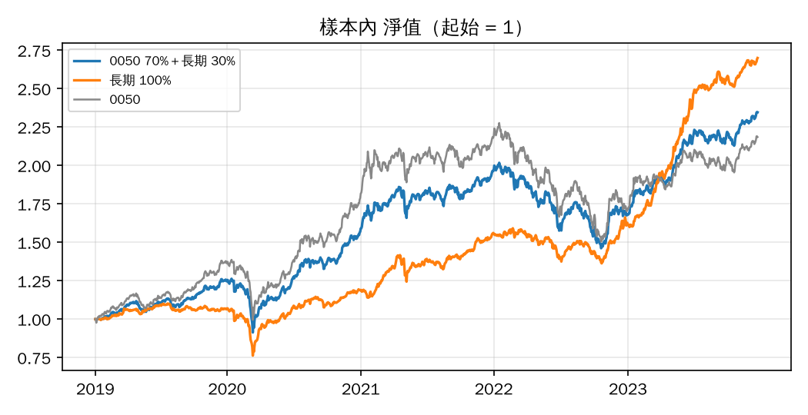
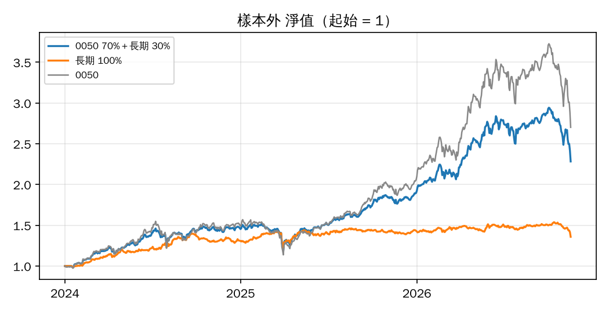

# 組合：0050 70%＋長期 30% 回測

> 模型依公開資料與固定規則產生，回測不代表未來，非投資建議。

產生時間（UTC）：2026-11-22 23:26　｜　原始數字：`tw-models/reports/combo_backtest.json`

## 說明
- 組合：0050 占 70%、長期名單占 30%（8 檔平分），每季（1、4、7、10 月 15 日後第一個交易日）再平衡回 70／30；權重偏離不到 2 個百分點的部位不調整。
- 組合與長期 100% 都從第一個換股日（約 1 月 16 日）才開始投入，期初約兩週為現金；0050 100% 第一天就買進。
- 規則事先固定，樣本內、樣本外各跑一次，沒有調整參數。
- 股票池包含 43 檔 2019 年後下市的上市股票（其中 43 檔取得價格資料），以降低倖存者偏差。

## 樣本內（2019–2023，用來訂規則）

期間：2019-01-01 ～ 2023-12-31

| 指標 | 0050 70%＋長期 30% | 長期 100% | 0050 |
|---|---|---|---|
| 總報酬 | 134.66% | 169.98% | 118.55% |
| 年化報酬 | 19.35% | 22.87% | 17.6% |
| 最大回撤 | -27.65% | -30.77% | -33.95% |
| 夏普值 | 1.21 | 1.59 | 0.97 |
| 交易次數 | 92 | 90 | 0 |
| 勝率 | 71.7% | 71.1% |  |
| 平均持有天數 | 106.0 | 98.9 |  |
| 年週轉率 | 0.75 倍 | 2.39 倍 | 0.0 倍 |
| 成本占報酬比例 | 2.9% | 6.2% | 0.2% |

**逐年報酬（%）**

| 年 | 0050 70%＋長期 30% | 長期 100% | 0050 |
|---|---|---|---|
| 2019 | 24.67 | 6.43 | 36.34 |
| 2020 | 25.9 | 11.59 | 31.14 |
| 2021 | 25.1 | 31.45 | 21.92 |
| 2022 | -14.3 | 4.23 | -21.37 |
| 2023 | 39.45 | 65.93 | 27.51 |

## 樣本外（2024～今，用來驗證）

期間：2024-01-01 ～ 2026-11-20

| 指標 | 0050 70%＋長期 30% | 長期 100% | 0050 |
|---|---|---|---|
| 總報酬 | 128.31% | 35.88% | 170.19% |
| 年化報酬 | 34.78% | 11.72% | 43.24% |
| 最大回撤 | -22.42% | -14.36% | -27.51% |
| 夏普值 | 1.49 | 0.89 | 1.43 |
| 交易次數 | 52 | 46 | 0 |
| 勝率 | 76.9% | 73.9% |  |
| 平均持有天數 | 131.6 | 94.4 |  |
| 年週轉率 | 0.67 倍 | 2.12 倍 | 0.0 倍 |
| 成本占報酬比例 | 1.7% | 13.3% | 0.1% |

**逐年報酬（%）**

| 年 | 0050 70%＋長期 30% | 長期 100% | 0050 |
|---|---|---|---|
| 2024 | 46.4 | 31.09 | 50.3 |
| 2025 | 29.64 | 9.24 | 36.86 |
| 2026 | 20.29 | -5.11 | 31.34 |
