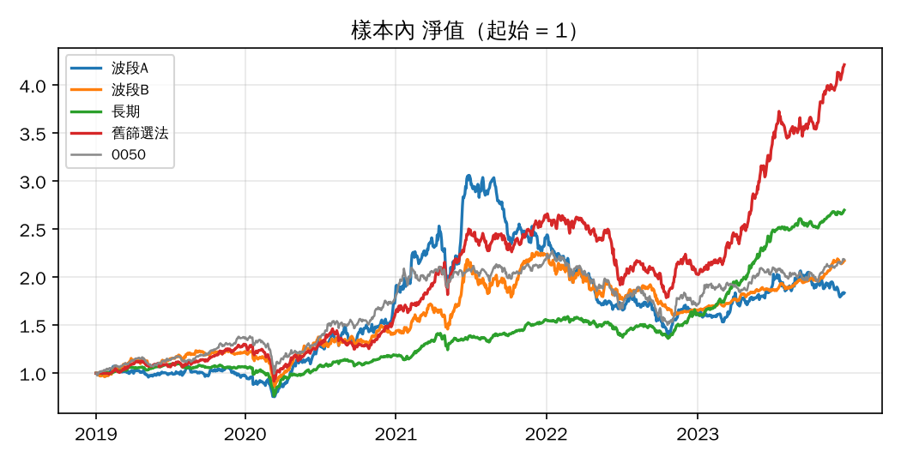
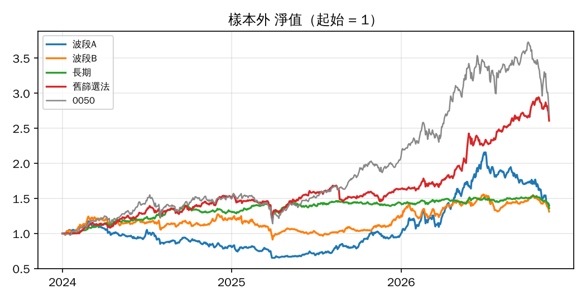

# 五組比較（波段兩種出場、長期、舊篩選法、0050） 回測

> 模型依公開資料與固定規則產生，回測不代表未來，非投資建議。

產生時間（UTC）：2026-11-22 22:29　｜　原始數字：`tw-models/reports/comparison_backtest.json`

## 說明
- 訊號用當天收盤後資料，隔天開盤成交；手續費 ×0.6 折、證交稅（一般股 0.3%、ETF 0.1%）、滑價 0.1%；含息（還原權息價）；現金不計利息。
- 樣本內（2019–2023）與樣本外（2024～今）各自從 100 萬元開始；規則在樣本內訂好後，未依樣本外結果調整。
- 股票池包含 43 檔 2019 年後下市的上市股票（其中 43 檔取得價格資料），以降低倖存者偏差。

## 樣本內（2019–2023，用來訂規則）

期間：2019-01-01 ～ 2023-12-31

| 指標 | 波段A | 波段B | 長期 | 舊篩選法 | 0050 |
|---|---|---|---|---|---|
| 總報酬 | 83.73% | 117.35% | 169.98% | 321.44% | 118.55% |
| 年化報酬 | 13.45% | 17.47% | 22.87% | 34.76% | 17.6% |
| 最大回撤 | -54.08% | -30.79% | -30.77% | -32.86% | -33.95% |
| 夏普值 | 0.64 | 0.92 | 1.59 | 1.6 | 0.97 |
| 交易次數 | 833 | 66 | 90 | 278 | 0 |
| 勝率 | 34.2% | 51.5% | 71.1% | 57.6% |  |
| 平均持有天數 | 9.4 | 151.8 | 98.9 | 35.9 |  |
| 年週轉率 | 21.35 倍 | 0.82 倍 | 2.39 倍 | 6.54 倍 | 0.0 倍 |

**逐年報酬（%）**

| 年 | 波段A | 波段B | 長期 | 舊篩選法 | 0050 |
|---|---|---|---|---|---|
| 2019 | -2.36 | 21.64 | 6.43 | 29.81 | 36.34 |
| 2020 | 84.02 | 16.6 | 11.59 | 24.94 | 31.14 |
| 2021 | 34.46 | 57.89 | 31.45 | 63.15 | 21.92 |
| 2022 | -33.04 | -25.98 | 4.23 | -23.06 | -21.37 |
| 2023 | 13.58 | 31.12 | 65.93 | 107.02 | 27.51 |

## 樣本外（2024～今，用來驗證）

期間：2024-01-01 ～ 2026-11-20

| 指標 | 波段A | 波段B | 長期 | 舊篩選法 | 0050 |
|---|---|---|---|---|---|
| 總報酬 | 40.08% | 30.99% | 35.88% | 160.59% | 170.19% |
| 年化報酬 | 12.96% | 10.25% | 11.72% | 41.38% | 43.24% |
| 最大回撤 | -44.65% | -28.38% | -14.36% | -22.26% | -27.51% |
| 夏普值 | 0.56 | 0.54 | 0.89 | 1.71 | 1.43 |
| 交易次數 | 507 | 68 | 46 | 136 | 0 |
| 勝率 | 31.8% | 48.5% | 73.9% | 64.0% |  |
| 平均持有天數 | 8.6 | 90.8 | 94.4 | 40.1 |  |
| 年週轉率 | 22.06 倍 | 1.54 倍 | 2.12 倍 | 5.92 倍 | 0.0 倍 |

**逐年報酬（%）**

| 年 | 波段A | 波段B | 長期 | 舊篩選法 | 0050 |
|---|---|---|---|---|---|
| 2024 | -17.49 | 21.86 | 31.09 | 52.18 | 50.3 |
| 2025 | 18.8 | 1.44 | 9.24 | 7.03 | 36.86 |
| 2026 | 42.92 | 5.96 | -5.11 | 59.99 | 31.34 |
