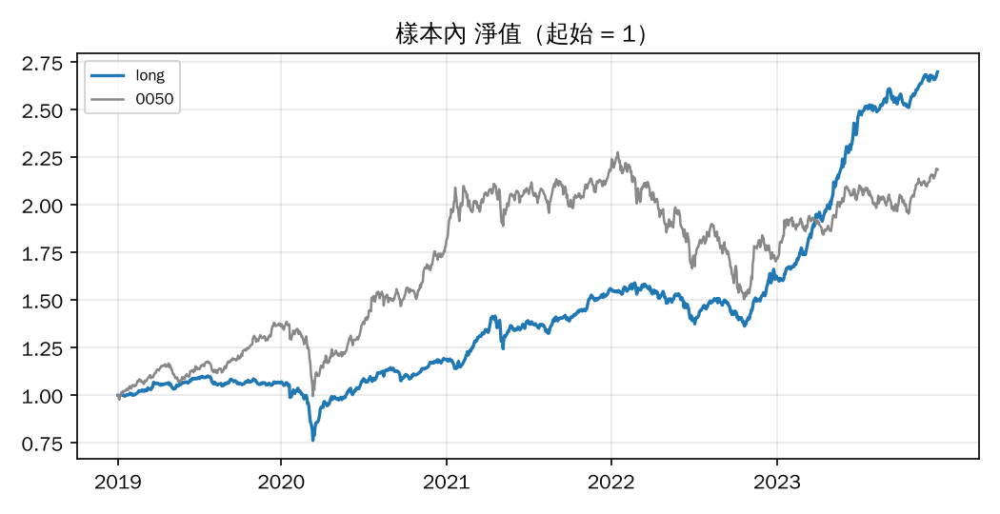
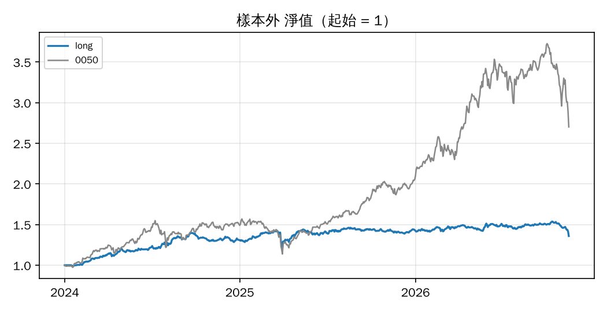

# E. 長期（long） 回測

> 模型依公開資料與固定規則產生，回測不代表未來，非投資建議。

產生時間（UTC）：2026-11-22 22:29　｜　原始數字：`tw-models/reports/long_backtest.json`

## 說明
- 訊號用當天收盤後資料，隔天開盤成交；手續費 ×0.6 折、證交稅（一般股 0.3%、ETF 0.1%）、滑價 0.1%；含息（還原權息價）；現金不計利息。
- 樣本內（2019–2023）與樣本外（2024～今）各自從 100 萬元開始；規則在樣本內訂好後，未依樣本外結果調整。
- 1、4、7、10 月 15 日後第一個交易日開盤換股（前一個交易日收盤後選股）；前 8 名等權重，同產業最多 3 檔。
- 股票池包含 43 檔 2019 年後下市的上市股票（其中 43 檔取得價格資料），以降低倖存者偏差。
- 現金股利以除權息結果中含「息」的事件判斷；權息合併事件的金額含股票股利，股利穩定判斷可能略有偏差。

## 樣本內（2019–2023，用來訂規則）

期間：2019-01-01 ～ 2023-12-31

| 指標 | long | 0050 |
|---|---|---|
| 總報酬 | 169.98% | 118.55% |
| 年化報酬 | 22.87% | 17.6% |
| 最大回撤 | -30.77% | -33.95% |
| 夏普值 | 1.59 | 0.97 |
| 交易次數 | 90 | 0 |
| 勝率 | 71.1% |  |
| 平均持有天數 | 98.9 |  |
| 年週轉率 | 2.39 倍 | 0.0 倍 |

**逐年報酬（%）**

| 年 | long | 0050 |
|---|---|---|
| 2019 | 6.43 | 36.34 |
| 2020 | 11.59 | 31.14 |
| 2021 | 31.45 | 21.92 |
| 2022 | 4.23 | -21.37 |
| 2023 | 65.93 | 27.51 |

## 樣本外（2024～今，用來驗證）

期間：2024-01-01 ～ 2026-11-20

| 指標 | long | 0050 |
|---|---|---|
| 總報酬 | 35.88% | 170.19% |
| 年化報酬 | 11.72% | 43.24% |
| 最大回撤 | -14.36% | -27.51% |
| 夏普值 | 0.89 | 1.43 |
| 交易次數 | 46 | 0 |
| 勝率 | 73.9% |  |
| 平均持有天數 | 94.4 |  |
| 年週轉率 | 2.12 倍 | 0.0 倍 |

**逐年報酬（%）**

| 年 | long | 0050 |
|---|---|---|
| 2024 | 31.09 | 50.3 |
| 2025 | 9.24 | 36.86 |
| 2026 | -5.11 | 31.34 |
