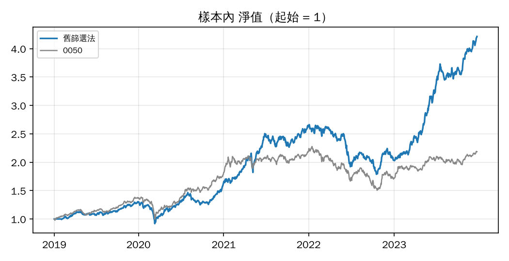
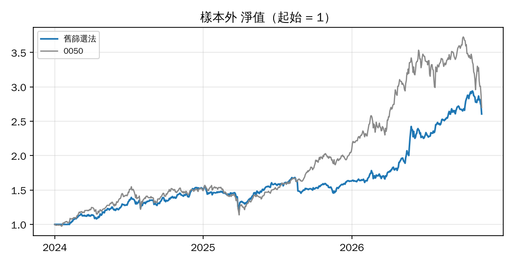

# F. 舊篩選法 回測

> 模型依公開資料與固定規則產生，回測不代表未來，非投資建議。

產生時間（UTC）：2026-11-22 22:29　｜　原始數字：`tw-models/reports/old_screen_backtest.json`

## 說明
- 訊號用當天收盤後資料，隔天開盤成交；手續費 ×0.6 折、證交稅（一般股 0.3%、ETF 0.1%）、滑價 0.1%；含息（還原權息價）；現金不計利息。
- 樣本內（2019–2023）與樣本外（2024～今）各自從 100 萬元開始；規則在樣本內訂好後，未依樣本外結果調整。
- 33 檔固定股票池；4 個條件各 1 分，每月最後一個交易日收盤後重排，取前 8 名等權重（同分以近 20 日報酬高者優先）。
- 注意：股票池是「現在」挑出來的 33 檔大型股，回測期間早期也用同一份名單，本身就有後見之明，報酬可能高估。

## 樣本內（2019–2023，用來訂規則）

期間：2019-01-01 ～ 2023-12-31

| 指標 | 舊篩選法 | 0050 |
|---|---|---|
| 總報酬 | 321.44% | 118.55% |
| 年化報酬 | 34.76% | 17.6% |
| 最大回撤 | -32.86% | -33.95% |
| 夏普值 | 1.6 | 0.97 |
| 交易次數 | 278 | 0 |
| 勝率 | 57.6% |  |
| 平均持有天數 | 35.9 |  |
| 年週轉率 | 6.54 倍 | 0.0 倍 |

**逐年報酬（%）**

| 年 | 舊篩選法 | 0050 |
|---|---|---|
| 2019 | 29.81 | 36.34 |
| 2020 | 24.94 | 31.14 |
| 2021 | 63.15 | 21.92 |
| 2022 | -23.06 | -21.37 |
| 2023 | 107.02 | 27.51 |

## 樣本外（2024～今，用來驗證）

期間：2024-01-01 ～ 2026-11-20

| 指標 | 舊篩選法 | 0050 |
|---|---|---|
| 總報酬 | 160.59% | 170.19% |
| 年化報酬 | 41.38% | 43.24% |
| 最大回撤 | -22.26% | -27.51% |
| 夏普值 | 1.71 | 1.43 |
| 交易次數 | 136 | 0 |
| 勝率 | 64.0% |  |
| 平均持有天數 | 40.1 |  |
| 年週轉率 | 5.92 倍 | 0.0 倍 |

**逐年報酬（%）**

| 年 | 舊篩選法 | 0050 |
|---|---|---|
| 2024 | 52.18 | 50.3 |
| 2025 | 7.03 | 36.86 |
| 2026 | 59.99 | 31.34 |
