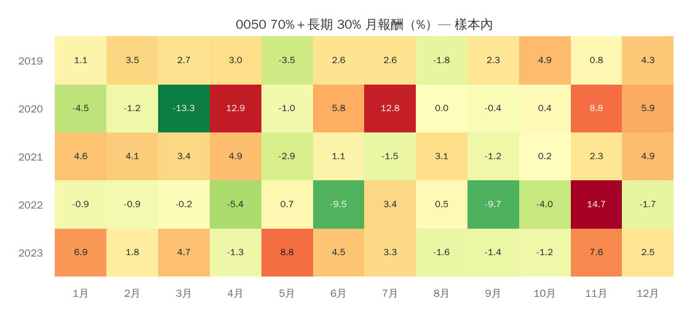
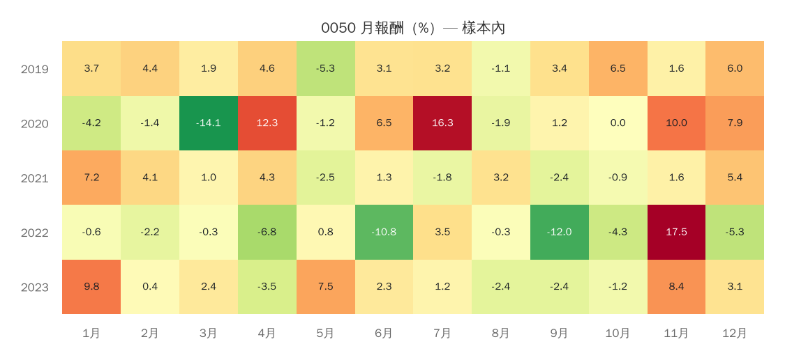
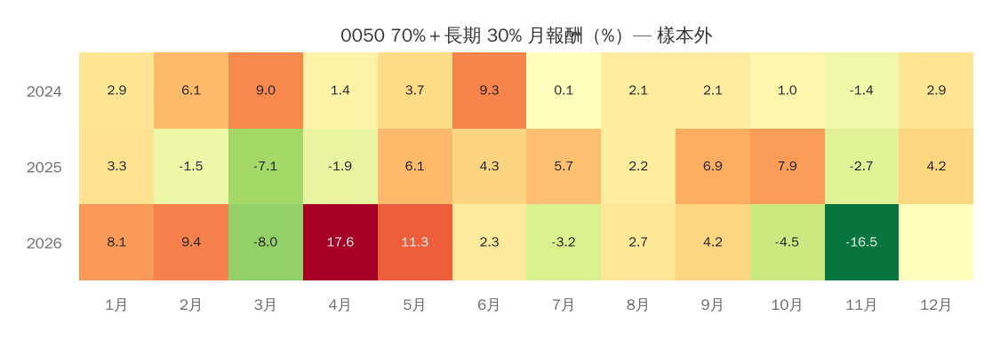
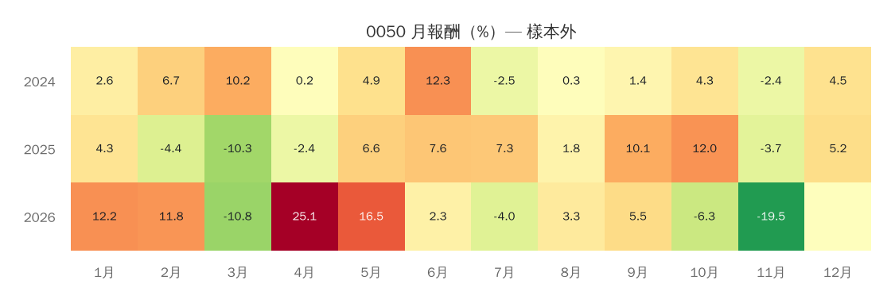

# 進階績效指標（quantstats）

> 模型依公開資料與固定規則產生，回測不代表未來，非投資建議。

用開源套件 quantstats（Apache-2.0）重新計算七三組合、長期名單和 0050 的回測績效。**只用來看報告和交叉驗證，模型規則沒有改（v1.0）。**

- 夏普值、索提諾值：日報酬、無風險利率 0、乘 √252，和 `backtest.py` 的算法一樣。
- 最長回撤天數：從前高到重新站回前高的日曆天數（還沒回到前高的就算到最後一天）。
- 單日風險值（95%）：歷史上 95% 的交易日，單日虧損不會超過這個數字。
- 月報酬熱力圖：紅色是上漲、綠色是下跌（台股習慣）。

## 樣本內（2019–2023，用來訂規則）

期間：2019-01-01 ～ 2023-12-31

| 指標 | 0050 70%＋長期 30% | 長期 100% | 0050 |
|---|---|---|---|
| 總報酬 | 134.66% | 169.98% | 118.55% |
| 年化報酬 | 19.35% | 22.87% | 17.6% |
| 年化波動 | 15.63% | 13.52% | 18.51% |
| 夏普值 | 1.21 | 1.59 | 0.97 |
| 索提諾值 | 1.76 | 2.25 | 1.44 |
| 最大回撤 | -27.65% | -30.77% | -33.95% |
| 最長回撤天數 | 493 天 | 377 天 | 711 天 |
| 卡瑪值（年化報酬÷最大回撤） | 0.7 | 0.74 | 0.52 |
| 月勝率 | 63.3% | 68.3% | 60.0% |
| 最佳月 | 14.68% | 14.98% | 17.46% |
| 最差月 | -13.27% | -12.76% | -14.1% |
| 單日風險值（95%） | -1.54% | -1.32% | -1.85% |

**0050 70%＋長期 30% 月報酬熱力圖**

**0050 月報酬熱力圖**

## 樣本外（2024～今，用來驗證）

期間：2024-01-01 ～ 2026-11-20

| 指標 | 0050 70%＋長期 30% | 長期 100% | 0050 |
|---|---|---|---|
| 總報酬 | 128.31% | 35.88% | 170.19% |
| 年化報酬 | 34.78% | 11.72% | 43.24% |
| 年化波動 | 21.63% | 13.52% | 27.87% |
| 夏普值 | 1.49 | 0.89 | 1.43 |
| 索提諾值 | 2.16 | 1.23 | 2.12 |
| 最大回撤 | -22.42% | -14.36% | -27.51% |
| 最長回撤天數 | 129 天 | 174 天 | 190 天 |
| 卡瑪值（年化報酬÷最大回撤） | 1.55 | 0.82 | 1.57 |
| 月勝率 | 74.3% | 62.9% | 71.4% |
| 最佳月 | 17.64% | 6.33% | 25.08% |
| 最差月 | -16.54% | -10.2% | -19.53% |
| 單日風險值（95%） | -2.11% | -1.35% | -2.73% |

**0050 70%＋長期 30% 月報酬熱力圖**

**0050 月報酬熱力圖**

## 交叉驗證：我們的回測引擎 vs quantstats

兩邊各自計算同一條淨值曲線，數字應該一致；不一致代表有一邊算錯。

| 期間 | 組合 | 夏普值（引擎）| 夏普值（quantstats）| 最大回撤（引擎）| 最大回撤（quantstats）| 總報酬（引擎）| 總報酬（quantstats）|
|---|---|---|---|---|---|---|---|
| 樣本內 | 0050 70%＋長期 30% | 1.21 | 1.21 | -27.65% | -27.65% | 134.66% | 134.66% |
| 樣本內 | 長期 100% | 1.59 | 1.59 | -30.77% | -30.77% | 169.98% | 169.98% |
| 樣本內 | 0050 | 0.97 | 0.97 | -33.95% | -33.95% | 118.55% | 118.55% |
| 樣本外 | 0050 70%＋長期 30% | 1.49 | 1.49 | -22.42% | -22.42% | 128.31% | 128.31% |
| 樣本外 | 長期 100% | 0.89 | 0.89 | -14.36% | -14.36% | 35.88% | 35.88% |
| 樣本外 | 0050 | 1.43 | 1.43 | -27.51% | -27.51% | 170.19% | 170.19% |

結果：全部一致。
