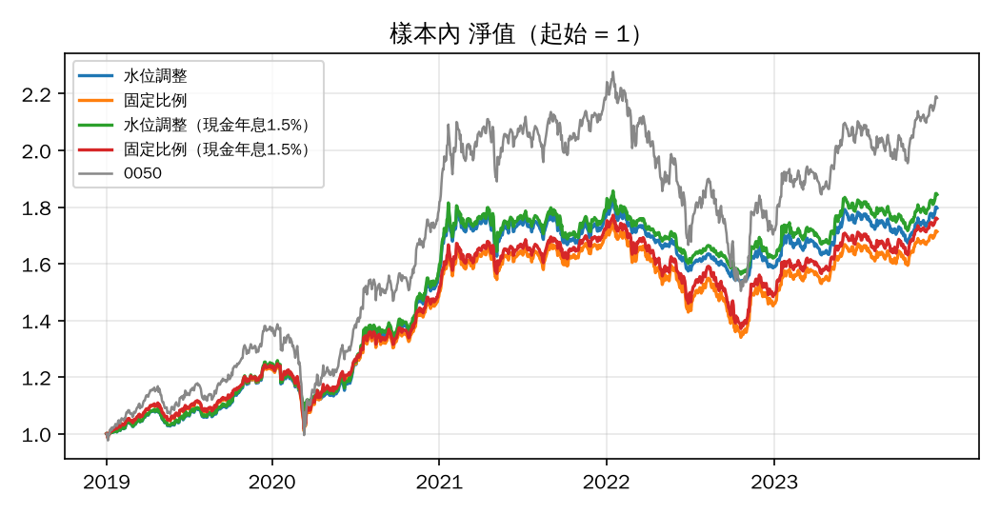
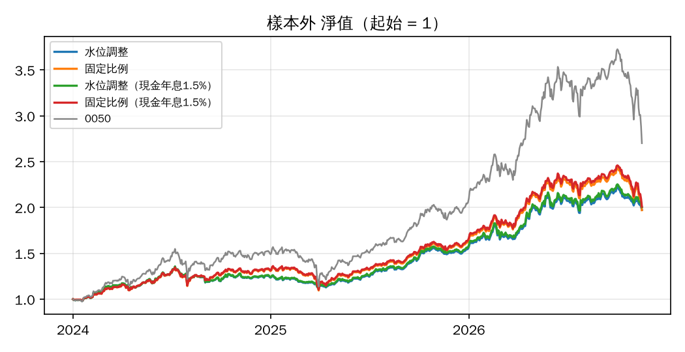

# 台股水位燈號（依水位調整持股 vs 滿倉） 回測

> 模型依公開資料與固定規則產生，回測不代表未來，非投資建議。

產生時間（UTC）：2026-11-22 09:27　｜　原始數字：`tw-models/reports/regime_tw_backtest.json`

## 說明
- 比較「依水位燈號調整 0050 持股比例」與「一直滿倉 0050」。
- 持股比例取各級距中點：0～2 分 90%、3～5 分 60%、6 分以上 30%；比例偏離超過 5 個百分點才調整。
- 「固定比例」= 一直維持水位版在同一期間的平均持股比例（樣本內 63.9%、樣本外 64.8%），用來檢驗燈號是否真的有擇時效果：水位版要贏固定比例版，才代表燈號有用。
- 注意：固定比例用的是「同一期間事後算出的平均比例」，實務上事前無法知道，只作為檢驗用的比較組。
- 「現金年息1.5%」版本：未投入的現金每個交易日計息（年息 ÷ 252）；其餘版本現金不計利息。
- 訊號用當天收盤後資料，隔天開盤成交；含手續費、證交稅（ETF 0.1%）、滑價 0.1%。

## 樣本內（2019–2023，用來訂規則）

期間：2019-01-01 ～ 2023-12-31

| 指標 | 水位調整 | 固定比例 | 水位調整（現金年息1.5%） | 固定比例（現金年息1.5%） | 0050 |
|---|---|---|---|---|---|
| 總報酬 | 79.67% | 71.34% | 84.42% | 75.87% | 118.55% |
| 年化報酬 | 12.92% | 11.82% | 13.53% | 12.42% | 17.6% |
| 最大回撤 | -16.43% | -23.1% | -15.82% | -22.6% | -33.95% |
| 夏普值 | 1.13 | 0.99 | 1.18 | 1.04 | 0.97 |
| 交易次數 | 59 | 5 | 59 | 5 | 0 |
| 勝率 | 62.7% | 100.0% | 62.7% | 100.0% |  |
| 平均持有天數 | 648.0 | 508.2 | 648.0 | 534.4 |  |
| 年週轉率 | 3.75 倍 | 0.05 倍 | 3.75 倍 | 0.05 倍 | 0.0 倍 |

**逐年報酬（%）**

| 年 | 水位調整 | 固定比例 | 水位調整（現金年息1.5%） | 固定比例（現金年息1.5%） | 0050 |
|---|---|---|---|---|---|
| 2019 | 23.39 | 22.72 | 23.92 | 23.31 | 36.34 |
| 2020 | 26.41 | 20.94 | 26.96 | 21.67 | 31.14 |
| 2021 | 12.98 | 14.05 | 13.45 | 14.68 | 21.92 |
| 2022 | -9.87 | -13.91 | -9.07 | -13.4 | -21.37 |
| 2023 | 13.12 | 17.58 | 13.63 | 18.03 | 27.51 |

## 樣本外（2024～今，用來驗證）

期間：2024-01-01 ～ 2026-11-20

| 指標 | 水位調整 | 固定比例 | 水位調整（現金年息1.5%） | 固定比例（現金年息1.5%） | 0050 |
|---|---|---|---|---|---|
| 總報酬 | 97.57% | 97.17% | 100.48% | 101.02% | 170.19% |
| 年化報酬 | 27.91% | 27.82% | 28.59% | 28.72% | 43.24% |
| 最大回撤 | -17.89% | -19.15% | -17.5% | -18.91% | -27.51% |
| 夏普值 | 1.56 | 1.43 | 1.59 | 1.47 | 1.43 |
| 交易次數 | 54 | 5 | 54 | 5 | 0 |
| 勝率 | 72.2% | 100.0% | 72.2% | 100.0% |  |
| 平均持有天數 | 309.9 | 392.4 | 309.9 | 413.0 |  |
| 年週轉率 | 5.67 倍 | 0.1 倍 | 5.66 倍 | 0.1 倍 | 0.0 倍 |

**逐年報酬（%）**

| 年 | 水位調整 | 固定比例 | 水位調整（現金年息1.5%） | 固定比例（現金年息1.5%） | 0050 |
|---|---|---|---|---|---|
| 2024 | 24.14 | 31.49 | 24.72 | 32.16 | 50.3 |
| 2025 | 24.95 | 23.62 | 25.69 | 24.26 | 36.86 |
| 2026 | 27.37 | 21.3 | 27.9 | 22.4 | 31.34 |
