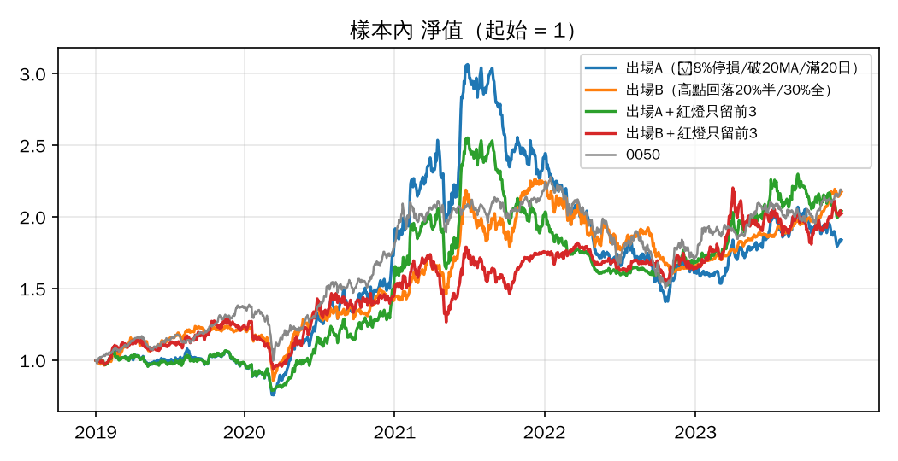
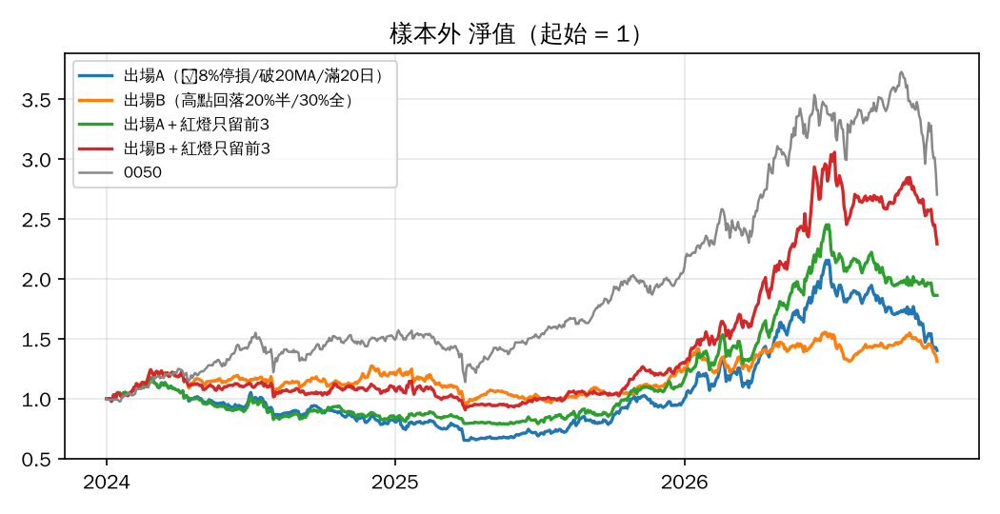

# D. 波段（swing） 回測

> 模型依公開資料與固定規則產生，回測不代表未來，非投資建議。

產生時間（UTC）：2026-11-22 22:29　｜　原始數字：`tw-models/reports/swing_backtest.json`

## 說明
- 訊號用當天收盤後資料，隔天開盤成交；手續費 ×0.6 折、證交稅（一般股 0.3%、ETF 0.1%）、滑價 0.1%；含息（還原權息價）；現金不計利息。
- 樣本內（2019–2023）與樣本外（2024～今）各自從 100 萬元開始；規則在樣本內訂好後，未依樣本外結果調整。
- 每週最後一個交易日收盤後排名，下一個交易日開盤進場；前 8 名等權重，有空位才補。
- 股票池包含 43 檔 2019 年後下市的上市股票（其中 43 檔取得價格資料），以降低倖存者偏差。
- 全額交割股的歷史名單取不到，未排除（股價 > 10 元、20 日均量 > 1,000 張已排除大多數）。

## 樣本內（2019–2023，用來訂規則）

期間：2019-01-01 ～ 2023-12-31

| 指標 | 出場A（−8%停損/破20MA/滿20日） | 出場B（高點回落20%半/30%全） | 出場A＋紅燈只留前3 | 出場B＋紅燈只留前3 | 0050 |
|---|---|---|---|---|---|
| 總報酬 | 83.73% | 117.35% | 103.92% | 102.11% | 118.55% |
| 年化報酬 | 13.45% | 17.47% | 15.93% | 15.71% | 17.6% |
| 最大回撤 | -54.08% | -30.79% | -40.31% | -27.21% | -33.95% |
| 夏普值 | 0.64 | 0.92 | 0.77 | 0.78 | 0.97 |
| 交易次數 | 833 | 66 | 747 | 212 | 0 |
| 勝率 | 34.2% | 51.5% | 36.1% | 44.3% |  |
| 平均持有天數 | 9.4 | 151.8 | 9.2 | 49.6 |  |
| 年週轉率 | 21.35 倍 | 0.82 倍 | 19.33 倍 | 4.46 倍 | 0.0 倍 |

**逐年報酬（%）**

| 年 | 出場A（−8%停損/破20MA/滿20日） | 出場B（高點回落20%半/30%全） | 出場A＋紅燈只留前3 | 出場B＋紅燈只留前3 | 0050 |
|---|---|---|---|---|---|
| 2019 | -2.36 | 21.64 | -2.07 | 23.59 | 36.34 |
| 2020 | 84.02 | 16.6 | 58.17 | 17.29 | 31.14 |
| 2021 | 34.46 | 57.89 | 29.91 | 21.26 | 21.92 |
| 2022 | -33.04 | -25.98 | -16.02 | -6.17 | -21.37 |
| 2023 | 13.58 | 31.12 | 20.67 | 22.54 | 27.51 |

## 樣本外（2024～今，用來驗證）

期間：2024-01-01 ～ 2026-11-20

| 指標 | 出場A（−8%停損/破20MA/滿20日） | 出場B（高點回落20%半/30%全） | 出場A＋紅燈只留前3 | 出場B＋紅燈只留前3 | 0050 |
|---|---|---|---|---|---|
| 總報酬 | 40.08% | 30.99% | 86.12% | 129.07% | 170.19% |
| 年化報酬 | 12.96% | 10.25% | 25.18% | 34.94% | 43.24% |
| 最大回撤 | -44.65% | -28.38% | -33.24% | -27.08% | -27.51% |
| 夏普值 | 0.56 | 0.54 | 0.97 | 1.27 | 1.43 |
| 交易次數 | 507 | 68 | 458 | 144 | 0 |
| 勝率 | 31.8% | 48.5% | 34.3% | 41.7% |  |
| 平均持有天數 | 8.6 | 90.8 | 8.6 | 44.5 |  |
| 年週轉率 | 22.06 倍 | 1.54 倍 | 20.2 倍 | 5.04 倍 | 0.0 倍 |

**逐年報酬（%）**

| 年 | 出場A（−8%停損/破20MA/滿20日） | 出場B（高點回落20%半/30%全） | 出場A＋紅燈只留前3 | 出場B＋紅燈只留前3 | 0050 |
|---|---|---|---|---|---|
| 2024 | -17.49 | 21.86 | -14.45 | 9.8 | 50.3 |
| 2025 | 18.8 | 1.44 | 33.36 | 18.61 | 36.86 |
| 2026 | 42.92 | 5.96 | 63.12 | 75.89 | 31.34 |
