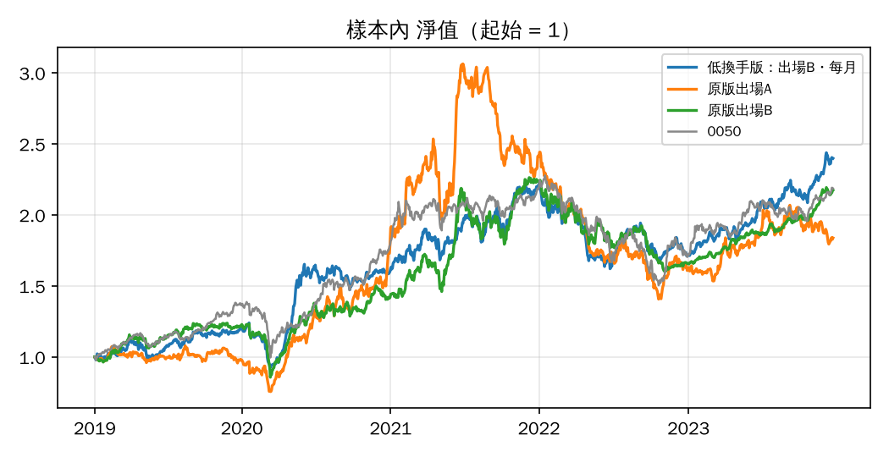
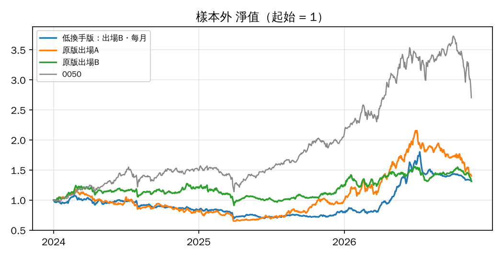

# D. 波段低換手版 回測

> 模型依公開資料與固定規則產生，回測不代表未來，非投資建議。

產生時間（UTC）：2026-11-22 23:26　｜　原始數字：`tw-models/reports/swing_lowturn_backtest.json`

## 說明
- 低換手的三種做法：(a) 每月第一個交易日重排（原本每週）；(b) 持有中的股票只要還在前 20 名就不換（取消「持有滿 20 日」出場）；(c) 最少持有 20 個交易日（停損、30% 回落全賣、紅燈規則除外）。
- 樣本內共測 32 種組合（出場 A／B × a × b × c × 紅燈規則），**事先訂好以樣本內夏普值最高者為最佳版**，之後才對這一版跑一次樣本外。
- 成本占報酬比例 = （手續費＋證交稅＋滑價）÷ 扣成本前的獲利；扣成本前沒有獲利時不計算。
- 注意：測了 32 種組合再挑最好的，樣本內成績本身會偏樂觀，樣本外才是比較公平的檢驗。
- 股票池包含 43 檔 2019 年後下市的上市股票（其中 43 檔取得價格資料），以降低倖存者偏差。

## 樣本內（2019–2023，用來訂規則）

期間：2019-01-01 ～ 2023-12-31

| 指標 | 低換手版：出場B・每月 | 原版出場A | 原版出場B | 0050 |
|---|---|---|---|---|
| 總報酬 | 139.76% | 83.73% | 117.35% | 118.55% |
| 年化報酬 | 19.89% | 13.45% | 17.47% | 17.6% |
| 最大回撤 | -27.11% | -54.08% | -30.79% | -33.95% |
| 夏普值 | 1.03 | 0.64 | 0.92 | 0.97 |
| 交易次數 | 53 | 833 | 66 | 0 |
| 勝率 | 45.3% | 34.2% | 51.5% |  |
| 平均持有天數 | 181.7 | 9.4 | 151.8 |  |
| 年週轉率 | 0.61 倍 | 21.35 倍 | 0.82 倍 | 0.0 倍 |
| 成本占報酬比例 | 2.4% | 57.8% | 3.5% | 0.2% |

**逐年報酬（%）**

| 年 | 低換手版：出場B・每月 | 原版出場A | 原版出場B | 0050 |
|---|---|---|---|---|
| 2019 | 19.88 | -2.36 | 21.64 | 36.34 |
| 2020 | 33.65 | 84.02 | 16.6 | 31.14 |
| 2021 | 37.52 | 34.46 | 57.89 | 21.92 |
| 2022 | -22.25 | -33.04 | -25.98 | -21.37 |
| 2023 | 39.98 | 13.58 | 31.12 | 27.51 |

## 樣本外（2024～今，用來驗證）

期間：2024-01-01 ～ 2026-11-20

| 指標 | 低換手版：出場B・每月 | 原版出場A | 原版出場B | 0050 |
|---|---|---|---|---|
| 總報酬 | 31.55% | 40.08% | 30.99% | 170.19% |
| 年化報酬 | 10.42% | 12.96% | 10.25% | 43.24% |
| 最大回撤 | -35.8% | -44.65% | -28.38% | -27.51% |
| 夏普值 | 0.55 | 0.56 | 0.54 | 1.43 |
| 交易次數 | 54 | 507 | 68 | 0 |
| 勝率 | 29.6% | 31.8% | 48.5% |  |
| 平均持有天數 | 116.1 | 8.6 | 90.8 |  |
| 年週轉率 | 1.35 倍 | 22.06 倍 | 1.54 倍 | 0.0 倍 |
| 成本占報酬比例 | 7.1% | 52.6% | 10.2% | 0.1% |

**逐年報酬（%）**

| 年 | 低換手版：出場B・每月 | 原版出場A | 原版出場B | 0050 |
|---|---|---|---|---|
| 2024 | -16.32 | -17.49 | 21.86 | 50.3 |
| 2025 | -4.28 | 18.8 | 1.44 | 36.86 |
| 2026 | 64.23 | 42.92 | 5.96 | 31.34 |

## 樣本內全部組合（2019–2023）

依夏普值排序；**粗體**為選中的版本。0050 同期：總報酬 118.55%、最大回撤 -33.95%、夏普值 0.97。

| 版本 | 總報酬 | 最大回撤 | 夏普值 | 年週轉率 | 成本占報酬比例 |
|---|---|---|---|---|---|
| **出場B・每月** | 139.76% | -27.11% | 1.03 | 0.61 倍 | 2.4% |
| 出場B・每月・最少持有20日 | 139.55% | -27.31% | 1.03 | 0.61 倍 | 2.4% |
| 出場B・每週 | 117.35% | -30.79% | 0.92 | 0.82 倍 | 3.5% |
| 出場B・每週・最少持有20日 | 117.06% | -30.79% | 0.91 | 0.82 倍 | 3.5% |
| 出場A・每月・前20名緩衝・最少持有20日 | 113.09% | -33.41% | 0.86 | 8.58 倍 | 27.1% |
| 出場B・每月・前20名緩衝・最少持有20日 | 142.36% | -42.2% | 0.84 | 6.86 倍 | 19.9% |
| 出場B・每週・最少持有20日・紅燈前3 | 111.44% | -28.52% | 0.81 | 4.48 倍 | 17.0% |
| 出場A・每週・最少持有20日 | 117.97% | -40.91% | 0.78 | 13.45 倍 | 36.6% |
| 出場A・每週・最少持有20日・紅燈前3 | 111.68% | -36.37% | 0.78 | 13.77 倍 | 37.3% |
| 出場B・每週・紅燈前3 | 102.11% | -27.21% | 0.78 | 4.46 倍 | 17.8% |
| 出場B・每週・前20名緩衝 | 140.65% | -50.24% | 0.78 | 17.05 倍 | 41.3% |
| 出場A・每週・紅燈前3 | 103.92% | -40.31% | 0.77 | 19.33 倍 | 48.5% |
| 出場A・每週・前20名緩衝・最少持有20日 | 114.0% | -47.38% | 0.73 | 12.16 倍 | 35.4% |
| 出場B・每週・前20名緩衝・最少持有20日 | 111.73% | -47.14% | 0.71 | 9.63 倍 | 30.5% |
| 出場A・每週・前20名緩衝・最少持有20日・紅燈前3 | 90.41% | -41.43% | 0.68 | 12.36 倍 | 37.0% |
| 出場B・每週・前20名緩衝・紅燈前3 | 94.85% | -44.98% | 0.66 | 16.66 倍 | 46.4% |
| 出場A・每週 | 83.73% | -54.08% | 0.64 | 21.35 倍 | 57.8% |
| 出場B・每月・紅燈前3 | 56.47% | -26.52% | 0.58 | 2.03 倍 | 13.5% |
| 出場B・每月・最少持有20日・紅燈前3 | 56.27% | -26.78% | 0.57 | 2.03 倍 | 13.6% |
| 出場B・每月・前20名緩衝 | 69.75% | -48.02% | 0.55 | 7.82 倍 | 31.4% |
| 出場A・每週・前20名緩衝・紅燈前3 | 54.4% | -39.95% | 0.51 | 20.63 倍 | 62.0% |
| 出場A・每週・前20名緩衝 | 57.11% | -52.35% | 0.5 | 22.96 倍 | 66.1% |
| 出場B・每週・前20名緩衝・最少持有20日・紅燈前3 | 52.12% | -50.29% | 0.47 | 10.4 倍 | 45.0% |
| 出場A・每月・前20名緩衝・最少持有20日・紅燈前3 | 34.05% | -29.14% | 0.41 | 7.84 倍 | 47.2% |
| 出場B・每月・前20名緩衝・最少持有20日・紅燈前3 | 38.01% | -39.0% | 0.4 | 6.49 倍 | 41.4% |
| 出場A・每月・前20名緩衝 | 14.87% | -31.38% | 0.25 | 10.81 倍 | 71.6% |
| 出場A・每月・最少持有20日 | 10.09% | -37.49% | 0.2 | 10.55 倍 | 79.6% |
| 出場B・每月・前20名緩衝・紅燈前3 | 7.11% | -46.35% | 0.18 | 7.19 倍 | 77.2% |
| 出場A・每月 | -10.48% | -34.68% | -0.05 | 11.79 倍 | 138.2% |
| 出場A・每月・前20名緩衝・紅燈前3 | -14.93% | -29.81% | -0.12 | 9.49 倍 | 215.0% |
| 出場A・每月・最少持有20日・紅燈前3 | -21.06% | -36.9% | -0.17 | 9.35 倍 | 357.9% |
| 出場A・每月・紅燈前3 | -31.54% | -35.43% | -0.42 | 10.31 倍 | — |
