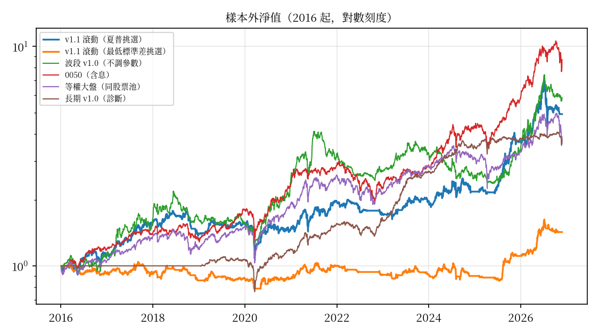

# 台股模型 v1.1 研究（滾動式驗證＋波段改版）

> **只做研究，不改正式規則。** v1.0 的設定、每日名單、儀表板資料檔、排程都沒有動。模型依公開資料與固定規則產生，回測不代表未來，非投資建議。

## 先講清楚
- **總共測了 24 組參數組合**（另有 4 個固定對照組，不調參數）。規則都在跑之前寫進 `tw-models/research/config_v11.json`，跑完沒有改。
- 驗證方法：**滾動式（擴張視窗）**。每年年初只用「前一年底以前」的資料挑出夏普值最高的一組，拿它跑這一年；2016～2026 每年一段，接成一條樣本外淨值。
- 另外列「改挑標準差最低的一組」當對照，主要結論看夏普值這條。
- 期間：2014-01-02 ～ 2026-11-24。法人買賣超資料從 2019 年才有，2016～2018 年的測試期少了「籌碼」因子。

## 結論

| | v1.1 滾動 | 0050 含息 | 波段 v1.0 |
|---|---|---|---|
| 年化報酬 | 16.33% | 22.82% | 18.27% |
| 最大回撤 | -39.37% | -33.96% | -42.25% |
| 夏普值 | 0.78 | 1.1 | 0.83 |
| 平均年週轉率 | 7.85 倍 | — | 18.86 倍 |

- **有沒有贏 0050**：**沒有，還是輸**（年化 16.33% 對 22.82%，夏普 0.78 對 1.1）。
- **有沒有贏 v1.0**：**沒有**（年化 16.33% 對 18.27%，夏普 0.78 對 0.83）。
- **換手率**：v1.1 平均每年 7.85 倍，v1.0 18.86 倍。**最大回撤**：v1.1 -39.37%，v1.0 -42.25%。

## 每年挑到的組合（夏普值挑選）

| 年 | 挑到的組合 | 當年報酬 | 當年週轉率 |
|---|---|---|---|
| 2016 | VAM60-5・不篩・月換股出場・紅燈不開新倉 | 13.34% | 6.06 倍 |
| 2017 | VAM60-5・篩低波動・月換股出場・紅燈不開新倉 | 37.72% | 9.15 倍 |
| 2018 | VAM60-5・篩低波動・月換股出場・紅燈不開新倉 | -10.16% | 6.41 倍 |
| 2019 | VAM60-5・篩低波動・月換股出場・紅燈留前 3 | 11.68% | 8.17 倍 |
| 2020 | VAM60-5・篩低波動・月換股出場・紅燈不開新倉 | -6.34% | 10.12 倍 |
| 2021 | VAM60-5・篩低波動・月換股出場・紅燈不開新倉 | 34.12% | 9.59 倍 |
| 2022 | VAM60-5・篩低波動・月換股出場・紅燈不開新倉 | -12.86% | 4.86 倍 |
| 2023 | VAM60-5・篩低波動・月換股出場・紅燈不開新倉 | 14.88% | 7.48 倍 |
| 2024 | VAM60-5・不篩・月換股出場・紅燈不開新倉 | 10.67% | 9.88 倍 |
| 2025 | VAM60-5・不篩・月換股出場・紅燈不開新倉 | 70.4% | 5.64 倍 |
| 2026 | VAM60-5・不篩・月換股出場・紅燈不開新倉 | 32.38% | 8.98 倍 |

## 對照組（2016 起）

| 組別 | 年化 | 最大回撤 | 夏普 | 平均年週轉 |
|---|---|---|---|---|
| v1.1 滾動（夏普挑選） | 16.33% | -39.37% | 0.78 | 7.85 倍 |
| v1.1 滾動（最低標準差挑選） | 3.43% | -24.76% | 0.34 | 9.54 倍 |
| 波段 v1.0（不調參數） | 18.27% | -42.25% | 0.83 | 18.86 倍 |
| 0050（含息） | 22.82% | -33.96% | 1.1 | — |
| 等權大盤（同股票池） | 13.74% | -36.28% | 0.74 | 1.78 倍 |
| 長期 v1.0（診斷） | 13.39% | -30.77% | 1.14 | 1.58 倍 |

## 逐年報酬（%）

| 年 | v1.1 滾動 | 0050 | 波段 v1.0 | 等權大盤 | 長期 v1.0 |
|---|---|---|---|---|---|
| 2016 | 13.34 | 19.65 | 10.44 | 5.39 | 0.0 |
| 2017 | 37.72 | 18.14 | 46.28 | 28.74 | 0.0 |
| 2018 | -10.16 | -4.94 | 0.96 | -10.8 | 0.0 |
| 2019 | 11.68 | 33.52 | -3.4 | 24.55 | 6.43 |
| 2020 | -6.34 | 31.14 | 58.17 | 27.7 | 11.59 |
| 2021 | 34.12 | 21.92 | 29.91 | 34.61 | 31.45 |
| 2022 | -12.86 | -21.37 | -16.02 | -18.09 | 4.23 |
| 2023 | 14.88 | 27.51 | 20.67 | 35.24 | 65.93 |
| 2024 | 10.67 | 48.64 | -21.05 | 7.98 | 29.02 |
| 2025 | 70.4 | 36.86 | 33.36 | 6.64 | 8.96 |
| 2026 | 32.38 | 48.84 | 69.29 | 17.37 | -1.03 |

「等權大盤」和 0050 的差距，大致就是「沒有重壓台積電」造成的落差。
長期 v1.0 要有 5 年歷史資料才開始選股，報酬為 0 的年份是還沒開始持股，所以它的年化報酬被低估，只能看開始持股後的逐年表現。

## 參數敏感度（24 組各自 2016 起的成績）

| 組合 | 年化 | 最大回撤 | 夏普 | 平均年週轉 |
|---|---|---|---|---|
| VAM60-5・篩低波動・月換股出場・紅燈不開新倉 | 15.51% | -38.03% | 0.84 | 7.7 倍 |
| VAM60-5・篩低波動・月換股出場・紅燈留前 3 | 15.83% | -37.25% | 0.84 | 8.21 倍 |
| VAM60-5・不篩・月換股出場・紅燈不開新倉 | 19.46% | -53.22% | 0.82 | 7.64 倍 |
| VAM60-5・不篩・月換股出場・紅燈留前 3 | 18.76% | -51.32% | 0.79 | 8.11 倍 |
| VAM60-5・篩低波動・2×ATR 停損・紅燈不開新倉 | 10.74% | -22.61% | 0.7 | 7.89 倍 |
| VAM21・不篩・月換股出場・紅燈留前 3 | 14.93% | -54.19% | 0.69 | 9.2 倍 |
| VAM60-5・篩低波動・2×ATR 停損・紅燈留前 3 | 10.78% | -26.24% | 0.69 | 8.44 倍 |
| VAM21・不篩・月換股出場・紅燈不開新倉 | 14.36% | -56.09% | 0.68 | 8.58 倍 |
| VAM60-5・不篩・2×ATR 停損・紅燈留前 3 | 12.29% | -36.25% | 0.64 | 8.44 倍 |
| VAM60-5・不篩・2×ATR 停損・紅燈不開新倉 | 12.05% | -36.53% | 0.63 | 7.93 倍 |
| VAM21・不篩・2×ATR 停損・紅燈留前 3 | 10.39% | -40.74% | 0.58 | 9.32 倍 |
| VAM21・篩低波動・月換股出場・紅燈不開新倉 | 8.76% | -44.04% | 0.54 | 8.59 倍 |
| VAM21・不篩・2×ATR 停損・紅燈不開新倉 | 8.96% | -43.06% | 0.53 | 8.65 倍 |
| VAM21・篩低波動・月換股出場・紅燈留前 3 | 8.6% | -41.74% | 0.53 | 9.22 倍 |
| VAM21・篩低波動・2×ATR 停損・紅燈不開新倉 | 5.84% | -32.49% | 0.44 | 8.66 倍 |
| VAM21・篩低波動・2×ATR 停損・紅燈留前 3 | 5.48% | -28.76% | 0.41 | 9.33 倍 |
| VAM60-5・篩低波動・v1.0 出場・紅燈不開新倉 | 3.68% | -21.65% | 0.36 | 9.55 倍 |
| VAM21・不篩・v1.0 出場・紅燈不開新倉 | 2.08% | -50.65% | 0.21 | 9.57 倍 |
| VAM60-5・不篩・v1.0 出場・紅燈不開新倉 | 1.56% | -38.27% | 0.18 | 9.57 倍 |
| VAM60-5・篩低波動・v1.0 出場・紅燈留前 3 | 1.5% | -29.75% | 0.18 | 10.35 倍 |
| VAM21・不篩・v1.0 出場・紅燈留前 3 | 1.47% | -48.01% | 0.17 | 10.42 倍 |
| VAM21・篩低波動・v1.0 出場・紅燈不開新倉 | 1.17% | -36.02% | 0.16 | 9.56 倍 |
| VAM60-5・不篩・v1.0 出場・紅燈留前 3 | -0.56% | -46.47% | 0.05 | 10.33 倍 |
| VAM21・篩低波動・v1.0 出場・紅燈留前 3 | -0.58% | -36.02% | 0.02 | 10.38 倍 |

### 各選項的平均夏普值

| 選項 | 平均夏普 |
|---|---|
| 動能：VAM21 | 0.41 |
| 動能：VAM60-5 | 0.56 |
| 低波動：篩低波動 | 0.48 |
| 低波動：不篩 | 0.5 |
| 出場：月換股出場 | 0.72 |
| 出場：2×ATR 停損 | 0.58 |
| 出場：v1.0 出場 | 0.17 |
| 紅燈：紅燈不開新倉 | 0.51 |
| 紅燈：紅燈留前 3 | 0.47 |

注意：這張表是 24 組「事後」的成績，挑最好的一組來看會偏樂觀；公平的成績是上面的滾動結果。

## 規則說明
- 股票池、成本、成交（隔天開盤含滑價）、籌碼與營收因子都和 v1.0 相同；每月第一個交易日排名，持有前 8 名等權。
- 動能：VAM21 = 近 21 日報酬 ÷ 近 21 日日報酬標準差；VAM60-5 = 近 60 日報酬（扣最近 5 日）÷ 同期標準差。
- 篩低波動：先排除近 60 日波動度最高的 30% 再排名。
- 出場：月換股出場 = 只在換股日跌出前 8 名才賣；2×ATR = 另外收盤跌破「進場價 − 2×ATR(20)」就賣；v1.0 出場 = 另外照 v1.0 出場 A（−8%、破 20 日線、滿 20 日）。
- 紅燈：不開新倉 = 水位總分 ≥ 6 時不買新股，已持有照出場規則；留前 3 = v1.0 規則。
- 波段 v1.0 對照組照 v1.0 原樣（每週換股、出場 A、紅燈留前 3）。長期 v1.0 只做診斷，規則沒改。
- 股票池包含 43 檔 2019 年後下市的上市股票（其中 43 檔取得價格資料），以降低倖存者偏差。
